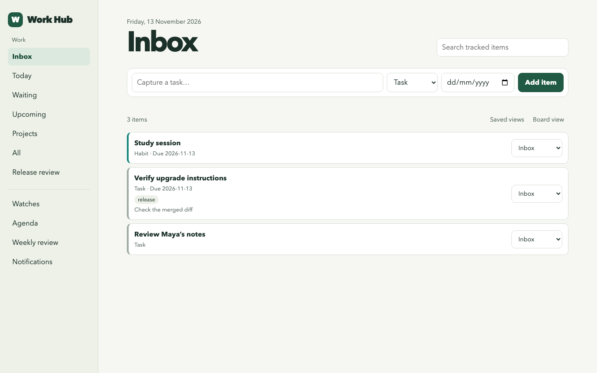

They say necessity is the mother of invention. I needed a way to keep tabs on everything I had going on, so I built something that works for me. If you’re struggling to keep track of your own work, it might work for you too.

I called it Work Hub. I can keep adding whatever I need to track and see it on a dashboard. A review request comes with a link and a status. “I’ll get back to you” comes with the private conviction that I’ll remember who *you* is tomorrow. I can put both in the same brief.

When I pick something up again, I want the reason it mattered, the decision I made, and the next action. And if I’ve already shown Claude how I want the brief to work, I’d like to have that conversation once.

## What Work Hub remembers

- **Local Markdown, set up automatically.** On the first Claude Code session after installation, Work Hub adds any missing starter files under `~/.claude/work-hub/`, including its own `CLAUDE.md`, `persona.md`, and `MEMORY.md`. 
  It also creates or updates the main `~/.claude/CLAUDE.md` so Claude can find the Work Hub instructions, and leaves any edits you’ve made to the starter files intact. [Session setup](https://github.com/gtrivedi88/work-hub/blob/9bca775/plugins/work-hub/skills/personal-workflow/scripts/personal_workflow.py#L647-L676)

- **Working preferences you can read and edit.** `persona.md` holds how I like to work, and `MEMORY.md` points Claude to project rules, checklists, and lessons it can use again. 
  If I correct how Claude handles a release date, it can save the preference during the conversation and tell me which file it changed. [Personalization skill](https://github.com/gtrivedi88/work-hub/blob/9bca775/plugins/work-hub/skills/personalize-workflow/SKILL.md) · [Where I wrote about using a persona file](/taking-yourself-out-of-the-equation/)

<figure class="wh-diagram" aria-labelledby="wh-memory-caption">
  

    <b>Claude Code starts</b> 
    <code>~/.claude/CLAUDE.md</code> imports the Work Hub instructions.
  

  ↓
  
<code>~/.claude/work-hub/</code>

  <ul class="wh-files" role="list">
    <li><code>CLAUDE.md</code> How Claude should run the brief and handle corrections.</li>
    <li><code>persona.md</code> Preferences I want Claude to use across projects.</li>
    <li><code>MEMORY.md</code> Where to find project rules, checklists, and lessons.</li>
  </ul>
  <figcaption id="wh-memory-caption">The startup hook creates missing starter files. I can open them in an editor and see what Claude will read.</figcaption>
</figure>

Say I tell Claude, “Show me where that release date came from.” If that’s a rule I want it to keep, Claude can save it in my preferences. “The release moved to Friday” belongs with this week’s work.

- **Decisions and their reasons.** For Jira work in the brief, Work Hub can record why it recommended something, what I picked up, and why I explicitly put something off. 
  In one test, the history shows why the upgrade guide came up (“Release is approaching”) and why the release notes went back on the list (“Still waiting for engineering”). [Decision history test](https://github.com/gtrivedi88/work-hub/blob/9bca775/tests/test_personal_workflow.py#L499-L507)

- **Where the work went next.** Work Hub keeps the draft stage, the next action I wrote down, and the dependency I’m waiting on for a selected Jira issue. 
  Later I can see that the implementation merged and I still need to check the flags in my draft, or see when the docs themselves shipped. [Draft and publication history test](https://github.com/gtrivedi88/work-hub/blob/9bca775/tests/test_personal_workflow.py#L511-L545)

<figure class="wh-diagram" aria-labelledby="wh-flow-caption">
  <ol class="wh-flow" role="list">
    <li>
      First brief
      <b>Upgrade guide comes up</b>
      
Work Hub saves “Release is approaching.”

    </li>
    <li class="wh-wait">
      After the first draft
      <b>Wait for the merge</b>
      
The saved next action is “Verify flag names.”

    </li>
    <li class="wh-ready">
      Later brief
      <b>Implementation merged</b>
      
The draft comes back with the flag check still to do.

    </li>
    <li>
      After publication
      <b>Docs shipped</b>
      
The history records the URL of the published guide.

    </li>
  </ol>
  <figcaption id="wh-flow-caption">The upgrade guide in Work Hub’s simulated workflow test, from recommendation to publication.</figcaption>
</figure>

The test also simulates a failed review check. Work Hub says the dependency is unknown and keeps the draft where I left it. When the merge does come through, I can open the diff and check the flags. A green Jira badge is lovely. It has yet to proofread a command. [Workflow test](https://github.com/gtrivedi88/work-hub/blob/9bca775/tests/test_personal_workflow.py#L514-L545)

<figure>
  
  <figcaption>My Work Hub dashboard populated with sample tasks.</figcaption>
</figure>

## What Work Hub does

- **Quick capture.** Add a task as soon as it comes to mind, whether it’s a reply you owe, a question you need to ask, or a renewal you want to check. 
  Keep a link to the message or meeting note and write down what you need to do next.

- **Daily brief.** Run `/work-hub:personal-workflow` in Claude Code to see connected work alongside your own tasks, agenda, and alerts. 
  The brief points to its sources, suggests what to pick up, and shows when a source couldn’t be checked.

- **Connected work.** Pull Jira issues, GitHub and GitLab review requests, and GitLab to-dos into the brief. 
  With Slack or AEM connected in Claude Code, the brief can also look at relevant messages or check what’s already published.

- **Personalized dashboard.** Use the list or board to see your inbox, due work, and what’s waiting. 
  Edit dates, next actions, reminders, and tags from the dashboard, and use colors to pick out related work.

- **Search and saved views.** Find an old task by its title, tag, or the next action you wrote down. 
  Save a view you’ll want again, like upcoming release work, and keep work and personal items in separate workspaces if you prefer.

- **Changes since the last brief.** See which items appeared, changed status, or dropped out of a connected work list. 
  Work Hub compares two runs when it had complete results from the same account both times.

- **Task history.** Open an item to see when you added it, what changed, and which links or dependencies you attached. 
  A connected ticket or review can keep its own source status alongside the status you set for your work.

- **Projects and checklists.** Group tasks under a project or milestone and see how much is complete or waiting. 
  Save a checklist as a template so the next release starts with the steps you already worked out.

- **Dependencies and follow-ups.** Mark work as blocked by another item or set a date to check back. 
  For a tracked Jira assignment, the next brief can tell you when a linked issue is done or a code review has merged.

- **Recurring tasks and habits.** Set up work you do every week or a habit you want to check off each day. 
  Work Hub keeps the check-in history, including missed habit dates, and brings the current occurrence forward.

- **Reminders and snoozing.** Set a reminder for when you need to act or snooze an item until you’re ready to see it again. 
  On macOS, you can opt in to checks at login. You can also run the worker from a terminal.



## What I can check later

- **Agenda and time blocks.** Add an iCalendar feed or file and see your meetings alongside your planned tasks. 
  Schedule time for the work and export those dates or time blocks to another calendar.

- **Watches and alerts.** Watch a web page, an RSS feed, a public GitHub release or PR, or a local Radar signal bank. 
  Check what changed, when the last successful check ran, and which alerts are still unread. [How I built Radar](/personal-intelligence-system-radar/)

- **Time tracking and weekly review.** Start a timer or log the time you spent, then compare it with your estimate. 
  The weekly review shows what you finished, what’s still waiting, what carried over, and how your habits went.

- **Documentation handoff.** Pick a Jira issue in the brief and hand it to the separately installed docs orchestrator to start a draft in your docs checkout. 
  Work Hub can bring you back to the draft stage and next action you saved when it’s time to continue. [The documentation workflow I built before Work Hub](/modern-day-technical-writing-is-dead/)

- **Exports and backups.** Export items as Markdown, CSV, JSON, or iCalendar, depending on where you want to use them. 
  Back up the tracker, Jira work history, and personal Markdown, and restore them into a fresh profile.

- **Local use and optional connections.** Use `/work-hub:tracker` for tasks, habits, and the dashboard without a `.env` file. 
  For connected work, Work Hub can reuse your project or home `.env`. If neither file exists, it shows you the paths and keys to use.

You can try it [here](https://github.com/gtrivedi88/work-hub).

Questions?
